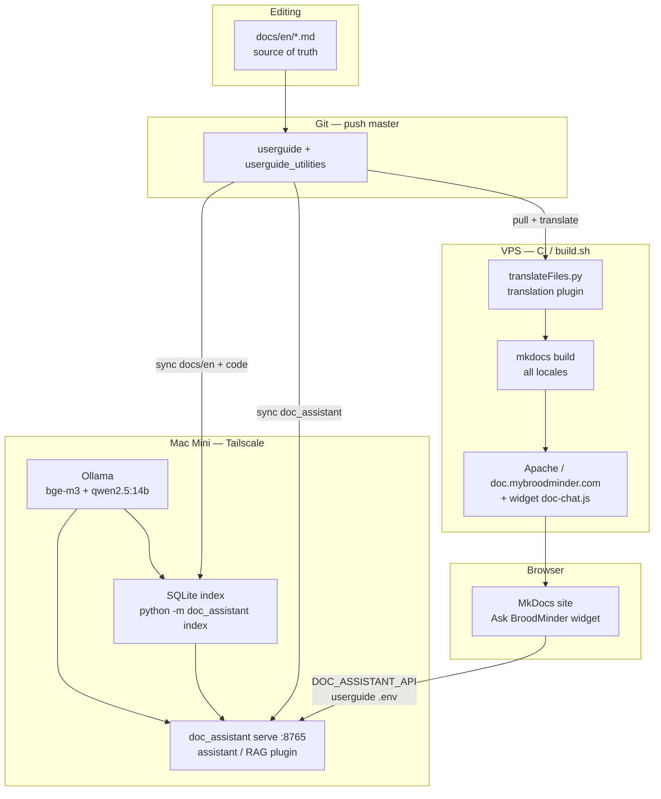

# userguide v1.6.1

## Architecture

Two separate pipelines share the same git repo: **translation** (VPS / CI) and **Ask BroodMinder** (Mac Mini + site widget).



| Component | Where | Role |
|-----------|--------|------|
| **Translation** (`translateFiles.py`) | VPS / `build.sh` | EN → fr/es/… then MkDocs site |
| **Assistant** (`doc_assistant`) | Mac Mini | Index EN + RAG API (Ollama) |
| **Widget** (`doc-chat.js`) | Site (userguide) | Chat UI → URL from `DOC_ASSISTANT_API` |

- Changing Mac = update `DOC_ASSISTANT_API` in `userguide/.env` and rebuild/redeploy the site.
- Reindex on the Mac only when `docs/en` (or chunking) changes — not on every translation run.
- Mac services: see `userguide_utilities/doc_assistant/deploy/`.

## Deployment

!!!note
    The following steps will deploy the userguide in local mode. It means that you will use the *light version* (`mkdocs_test.yml`: **English + French** only, no PDF export, no translation step).

1. Clone the repo on the VPS

`git clone https://github.com/broodminder/userguide /mellisphera/production/userguide`

!!! note
    The path at the end is refered to the vhost VPS, you can choose the one that you want on local.

2. Use a python virtualenv

To manage different librairies version between *userguide*, *hiveminder*, *flowminder*, etc, we need to use a python environment. If you don't have already a python env, please use the following command.

  `pyenv virtualenv 3.11.2 userguide`

  Then activate it
  `pyenv activate userguide`

3. Install all packages

`pip install -r requirements.txt`

4. Create .env file and replace variables

`cp .env.example .env`

In the [.env](.env) file, replace the variable **USERNAME** by your local username from your machine.

5. Export your environment

`export $(grep -v '^#' .env | xargs -0)`

6. Start the server (light, EN + FR, no translation)

`mkdocs serve -f mkdocs_test.yml`

Or build + copy to Apache without running `translateFiles.py`:

`./build_local.sh`  
(`SKIP_DEPLOY=1 ./build_local.sh` to only fill `./site/`)

7. Verify your site

On http://127.0.0.1:3200 if you use `mkdocs serve` (`dev_addr` in the yml), or on the DNS / path from your apache2 configuration (e.g. http://127.0.0.1/doc/ and http://127.0.0.1/doc/fr/).

!!!note
    Full production deploy (all languages + translation + PDF) still uses **build.sh**, which copies to `/var/www/html/doc`.

```
`sudo ./build.sh`
```

## Configuration file mkdocs.yml

This file allows for multiple options and configuration.
By default we are not changing much in it except site title, theme and new language (be carrefull, the whole translation process is based on the list of langs setted on the yaml file)

```yml
site_name: USER DOCUMENTATION
theme: material
nav:
```

_nav_ would allow to force the site doc structure tree, but the default output is fine too

### Multi-lang management

**Source of truth in git:** only `docs/en/` (plus shared `docs/assets/`). Other locales (`fr`, `es`, …) are **generated on the server** by `translateFiles.py` and are not the editable source.

Here is the main folder structure :

```
docs\
    en\*.md                 ← versioned content (English)
    fr\*.md / es\ …         ← generated at build (not the git source)
    overrides\en\home.html
    assets\**               ← shared images (served as /assets/…)
userguide_utilities\        ← git submodule (translation pipeline)
    translateFiles.py
    translation_glossary.py
mkdocs.yml
.env
RAG_AI.txt          (optional)
filesChange.txt     (generated by build.sh)
```

For now we have *en, fr, it, es, de, nl, ja, pt, nn, ar* languages (see **mkdocs.yml**).
If we want to add a new lang, add it first in the **mkdocs.yml** i18n plugin, then deploy: the first build will copy `docs/en/` to `docs/<locale>/` and translate everything.

#### Image / asset paths in Markdown

Always use a **root-absolute** path so images work under every language prefix (`/`, `/fr/`, `/es/`, …):

```markdown


```

Do **not** use relative paths like `../assets/...` or `../../assets/...`: on `/fr/page/` the browser resolves them to `/fr/assets/...` → **404**.  
The pipeline also rewrites `(../)+assets/` → `/assets/` before and after translation as a safety net. Never translate folder or file names inside asset paths (e.g. keep `30_sensors.assets`, not `30_sensores.assets`).

### Automated translation (`translateFiles.py`)

On the server, **build.sh** runs:

1. `git diff HEAD^ HEAD --name-only > filesChange.txt`
2. `python userguide_utilities/translateFiles.py`
3. `mkdocs build`

The script only processes paths containing `/en/` (`.md` or `.html`). For each target locale in `mkdocs.yml` (except `en`):

- **New locale** (no `docs/<lang>/` yet): copy `docs/en/` and `docs/overrides/en/`, then translate all files (**full corpus × API cost** — avoid creating missing locale folders by accident).
- **Existing locale**: copy each changed English file to `docs/<lang>/...` and run the translation pipeline on that copy.

> **Cost tip:** every path listed in `filesChange.txt` under `docs/en/` is translated into **all** locales. A large EN-only path fix committed then deployed via `build.sh` can trigger a big GPT bill. Prefer an empty / controlled `filesChange.txt` (or skip the translate step) when you only need `mkdocs build`.

#### Pipeline inside `translateFile` (per file)

| Step | Function | Role |
|------|----------|------|
| 1 | `prevent_asset_path` | Rewrites `(../)+assets/` → `/assets/` (HTML + Markdown) |
| 2 | `extract_i18n_video_directives` | Removes `<!-- i18n:video ... -->` comments; stores locale → YouTube id + thumbnail path |
| 3 | `protect_non_translatable_blocks` | Replaces `<script>`, YouTube `<div id="yt-...">`, etc. with tokens |
| 4 | `protect_paths` | Tokenizes Markdown / `src` / `href` destinations so the LLM cannot alter URLs or file paths |
| 5 | `translateText` | OpenAI GPT translates markdown + translatable HTML (`<h2>`, `<p>`, … inside tables) |
| 6 | `restore_protected_blocks` + `restore_paths` + `prevent_asset_path` | Restores tokens; re-normalizes asset paths |
| 7 | `apply_wrong_locale_term_fixes` | Fixes glossary leaks (e.g. French *rucher* on an Italian page) from `RAG_AI.txt` |
| 8 | `apply_i18n_video_directives` | Swaps video ids, embed URLs and thumbnail paths for the target locale |

Skipped files: `index.md`, `void.md`, anything under `/templates/`.

#### Environment variables (`.env`)

| Variable | Purpose |
|----------|---------|
| `OPENAI_API_KEY` | Required for translation (OpenAI GPT) |
| `OPENAI_API_MODEL` | GPT model (default: `gpt-4o-mini`) |
| `OVH_AI_ENDPOINTS_ACCESS_TOKEN` | Optional (OVH / MyBroodMinder, not used by translateText) |
| `RAG_AI_SETTINGS` | Optional path to glossary file (default: `./RAG_AI.txt`) |

Local run:

```bash
pyenv activate userguide
cd /path/to/userguide
export $(grep -v '^#' .env | xargs)
echo "docs/en/my_page.md" > filesChange.txt   # or use git diff output
python userguide_utilities/translateFiles.py
```

#### Optional glossary (`RAG_AI.txt`)

At the repository root, `RAG_AI.txt` is **optional**. If missing, translation uses the built-in system prompt only.

When present, `translation_glossary.py`:

- Injects mandatory EN→target terms into the LLM prompt (markdown tables).
- Applies a safety pass replacing terms from **other** languages that leaked into the output.

Edit after a bad translation: add columns (`Italian`, `German`, …) or a per-locale section:

```text
## it
- Apiary must be Apiario, never rucher or colmenar.
```

#### Embedded videos in Markdown (`i18n:video`)

In English source pages, declare locale-specific YouTube ids and thumbnail paths **before** each player block:

```html
<!-- i18n:video
locale: en | video_id: 6WicH4_l2FQ | thumb: /assets/.../EN_Onboarding_Video_Cover_500.png
locale: fr | video_id: 8eHAg2DPtsc | thumb: /assets/.../FR_Onboarding_Video_Cover_500.png
default: en
-->
<div id="yt-6WicH4_l2FQ">...</div>
```

After translation, comments are removed and ids/paths are updated for the target locale. Thumbnail files must exist under `docs/assets/...` (check filenames match the paths exactly).

The easiest way to add a new language in mkdocs is to copy the `fr` block in **mkdocs.yml**, append it at the end and adapt `nav_translations` (example below).

```yml
plugins:
  - search
  - i18n:
      docs_structure: folder
      fallback_to_default: true
      reconfigure_material: true
      reconfigure_search: true
      languages:
        - locale: en
          default: true
          name: 🇺🇸 English
          build: true
        - locale: fr
          link: /fr/
          name: 🇫🇷 Français
          build: true
          site_name: "GUIDE D'UTILISATEUR"
          nav_translations:
            Home: Accueil
            Quick start guide 🚀 : Guide de démarrage rapide 🚀
            Sensors: Capteurs
            Product range: Gamme de capteurs
            General aspects:  Aspects général
            Scale Assembly: Assemblage de la balance
            Yolink devices: Capteurs Yolink
            Example setups: Examples de configurations
            Data interpretation: Interprétation des données
            BroodMinder Device Updates: Mise à jour des capteurs BroodMinder
            BroodMinder Hub Updates: Mise à jour des hubs BroodMinder
            Video Library: Bibliothèques de vidéos
            Training Sessions: Sessions de tutoriels
            General: Général
            Tech Stuff and Physics: Tech Stuff and Physics
            Troubleshooting: Troubleshooting
            Repair Guide: Guide de réparation
            Distributors: Distributeurs
            Legacy Devices: Legacy Devices
            About: A propos
        - locale: i18n lang code
            link: /i18n lang code/
            name: 🇫(EMOJI FLAG) NEW LANG
            build: true
            # !!!! Then you need to translate by your self the following part
            site_name: "GUIDE D'UTILISATEUR"
            nav_translations:
                Home: Accueil
                Quick start guide 🚀 : Guide de démarrage rapide 🚀
                Sensors: Capteurs
                Product range: Gamme de capteurs
                General aspects:  Aspects général
                Scale Assembly: Assemblage de la balance
                Yolink devices: Capteurs Yolink
                Example setups: Examples de configurations
                Data interpretation: Interprétation des données
                BroodMinder Device Updates: Mise à jour des capteurs BroodMinder
                BroodMinder Hub Updates: Mise à jour des hubs BroodMinder
                Video Library: Bibliothèques de vidéos
                Training Sessions: Sessions de tutoriels
                General: Général
                Tech Stuff and Physics: Tech Stuff and Physics
                Troubleshooting: Troubleshooting
                Repair Guide: Guide de réparation
                Distributors: Distributeurs
                Legacy Devices: Legacy Devices
                About: A propos
```

After you finish everything, translation runs on the server at the end of the pull via **OpenAI GPT** (`OPENAI_API_MODEL`). Large pages are split into chunks (~2000 tokens); a full locale copy on first add can take a while.

## Annexes

### Using mkdocs

You have different commands to use the mkdocs framework.

**Create new project**
`mkdocs new my-project`

**Launch the development server at http://127.0.0.1:8000 (default)**
`mkdocs serve`

**Building the documentation html site**
`mkdocs build`

#### Utility

- MKDocs user guide https://www.mkdocs.org/
- converting Word to Markdown https://word2md.com/
- converting to pdf https://github.com/zhaoterryy/mkdocs-pdf-export-plugin This one is still explored, having an issue ongoing
- NOTE : Install all missing libraries with brew (same installer for python and mkdocs) to have everything in the same path

#### Mkdocs-Material reference

This resource details all available plugins and options for Material Theme
https://squidfunk.github.io/mkdocs-material/
https://squidfunk.github.io/mkdocs-material/reference/lists/

## Building a PDF file out of it

use the mkdocs-pdf-export-plugin
https://github.com/zhaoterryy/mkdocs-pdf-export-plugin
Note that this plugin is based onto WeasyPrint
https://weasyprint.readthedocs.io/en/latest/install.html

Works on MacOs and Linux.

Note for Mac users : use brew to install ALL packages and dependencies. Sometimes conflicts can arise if not all packages are installed in the same environment (ex Anaconda python or pip conflicting with Brew python3 or pip3)
