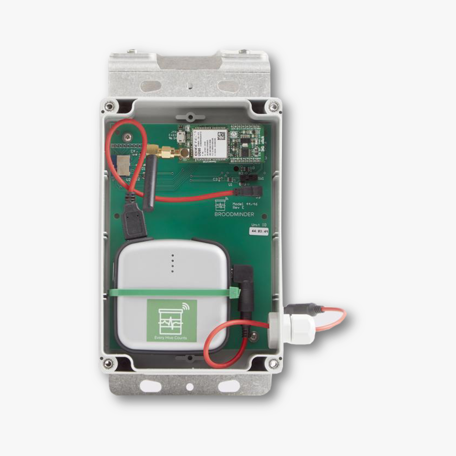
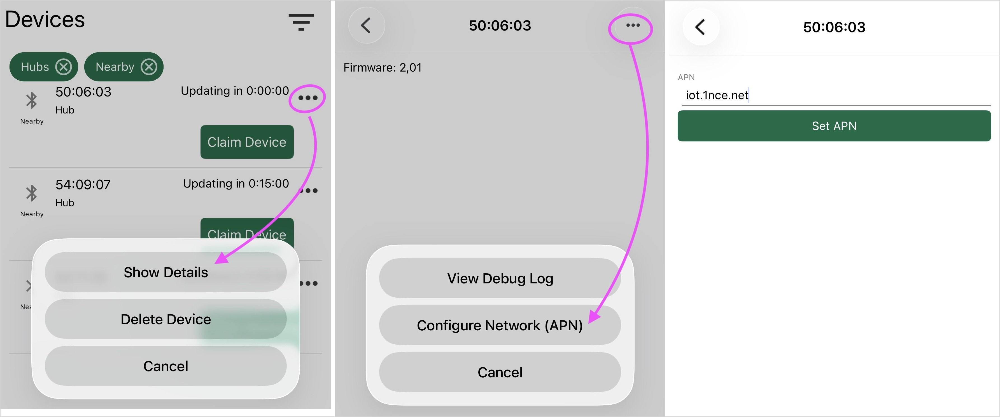

# BroodMinder-Cell 3G (BRM-44 & BRM-50)

The BroodMinder-Cell 3G hubs (models BRM-44 and BRM-50) have been in operation since 2018.

These hubs collect data from nearby BroodMinder devices and automatically transmit it to [MyBroodMinder](https://mybroodminder.com) over a cellular network.

!!! warning "3G Network Availability"
    3G networks have already been shut down in several countries, including the United States. However, these hubs continue to operate in regions where compatible cellular networks remain available.

    Before troubleshooting your hub, verify that a compatible 3G network is still operating in your area.

This guide covers installation, configuration, maintenance, and troubleshooting for these legacy models.



---

## 1. Getting Started

### Which App Should You Use?

The legacy **BroodMinder-Cell App** remains the primary application for configuring and troubleshooting BRM-44 and BRM-50 hubs.

It provides access to advanced functions, including:

- Hub configuration and diagnostics
- Cellular network diagnostics
- Custom APN configuration
- Modem communication traces
- Deep sleep management

The newer **BroodMinder Bees App** also supports certain functions, including APN configuration, but does not replace all the advanced diagnostics available in the legacy Cell App.

**BroodMinder-Cell App:** [Android](https://play.google.com/store/apps/details?id=com.broodminder.cell&hl=en_US&gl=US)

!!! tip "Which App Should I Use?"
    For basic hub monitoring and APN configuration, you can use the BroodMinder Bees App.

    For advanced cellular diagnostics and troubleshooting, use the legacy BroodMinder-Cell App.

### Quick Start

1. **Synchronize all your BroodMinder devices** and ensure their data has been uploaded to [MyBroodMinder](https://mybroodminder.com) before starting the hub.
2. Place the hub in your apiary, with the solar panel facing the sun.
3. Install and open the BroodMinder-Cell App.
4. Find your hub in the list of nearby devices.
5. Select **Exit Deep Sleep**, if the hub is in deep sleep mode.
6. Check the cellular network configuration and APN if necessary.
7. Allow the hub to establish a cellular connection.

Once connected, data should begin appearing in MyBroodMinder, typically within about an hour.

!!! note "Cellular Connectivity"
    Cellular connectivity depends on local network availability, signal strength, and an active SIM card.

    If your hub does not connect, refer to the [Cellular Network Troubleshooting](#6-connecting-to-the-cellular-network) section.

---

## 2. Installing the Hub

The BroodMinder-Cell hub can be installed in several configurations depending on your apiary.

The mounting bracket on the back of the electronics enclosure can be reversed to accommodate different mounting arrangements.


### Installation Recommendations

#### Solar Exposure

- Position the solar panel to receive as much direct sunlight as possible.
- Approximately **4 hours of good direct sunlight** can fully charge the battery under suitable conditions.
- A fully charged battery can typically provide **3–4 days of operation** without good sunlight.

!!! tip "Maximize Solar Charging"
    Install the hub in an open area where the solar panel receives direct sunlight for several hours each day.

    Avoid placing the panel under branches or in areas that remain shaded for most of the day.

#### Cellular Reception

- Avoid locations where trees or other obstacles significantly reduce cellular reception.
- Mounting the hub directly on a tree may cause connectivity problems in areas with weak signals.
- In difficult reception conditions, a higher-sensitivity cellular antenna may help.

!!! tip "Improving Cellular Reception"
    If your hub has difficulty connecting to the cellular network, try moving it to a more open location.

    In extreme cases, a more sensitive cellular antenna may be necessary. Contact [support@broodminder.com](mailto:support@broodminder.com) for assistance.

#### Mounting

- Use cable ties or pipe clamps to secure the hub.
- A short metal fence post (approximately 3 feet / 90 cm) is a practical mounting solution.
- Some fence posts have tabs that can be slightly bent to accommodate the hub.
- Secure the bottom of the unit with a cable tie to prevent movement.

!!! note "Installation"
    Make sure the installation is stable and that the solar panel remains exposed to sunlight throughout the day.

---

## 3. Solar Battery and Always-On Mode

The solar-powered configuration uses a **Voltaic V15 battery**.

BroodMinder hubs equipped with this battery are shipped with the battery configured in **Always-On mode**.

Under normal circumstances, you should not need to open the electronics enclosure or change the battery settings.

### Understanding the Two Power Modes

The Voltaic V15 battery supports two operating modes.

| Mode | Behavior |
|---|---|
| **Always-On** | Power remains available continuously |
| Auto-Off | Power automatically switches off after approximately 20 minutes under low-load conditions |

!!! warning "Always-On Mode Required"
    The battery must remain in **Always-On mode** for the hub to operate continuously.

    If the battery is set to Auto-Off mode, the hub may stop operating after approximately 20 minutes.

### Avoid Accidentally Changing the Mode

Holding the V15 power button for more than approximately 6 seconds switches between Always-On and Auto-Off modes.

!!! tip "Leave the Default Settings"
    BroodMinder hubs are shipped with the V15 battery already configured in **Always-On mode**.

    If you have not held the power button for an extended period, there is normally no reason to change anything.

### How to Check the Battery Mode

If you suspect the battery mode has changed:

1. Cover the solar panel to make the battery indicator lights easier to interpret.
2. Press and hold the V15 power button.
3. After approximately 6 seconds, the LEDs will flash three times.
4. Observe what happens immediately after the three flashes.

**Always-On mode (correct):**

The indicator light remains illuminated for a few more seconds after the three flashes.

Release the power button.

**Auto-Off mode (incorrect):**

The indicator lights turn off immediately after the three flashes.

Repeat the procedure to switch back to Always-On mode.

!!! warning "This Procedure Changes the Battery Mode"
    Holding the power button for 6 seconds toggles between Always-On and Auto-Off modes.

    Only perform this procedure if you need to verify or correct the current setting.

### Video: Activating Always-On Mode

[](https://www.youtube.com/watch?v=geVp0FDxm3U)

---

## 4. Understanding the Indicator Lights

The BRM-44 and BRM-50 hubs use indicator LEDs to show their operating status.

### Typical Startup Sequence

When the hub starts, you should normally observe the following sequence:

1. **D1 (orange):** Blinks several times during initialization.
2. **PWR1 (green):** Illuminates when the cellular modem is powered.
3. **STAT (yellow):** Illuminates during cellular modem activity.
4. Once the cellular connection has been established and the communication cycle is complete, the indicator lights turn off.

!!! info "Lights Turning Off Is Normal"
    After a successful cellular communication cycle, the indicator lights turn off.

    This is normal behavior and does not necessarily indicate that the hub has stopped working.

### Startup Images


### Checking the Modem Power

In the BroodMinder-Cell App, navigate to:

`Configure > Diagnostics > Cell network`

When running cellular diagnostics, the green **PWR1** LED should illuminate.

This indicates that the cellular modem is powered.

---

## 5. Installing or Replacing the SIM Card

The cellular hub requires a compatible SIM card to connect to the mobile network.

!!! warning "Power Off Before Handling the SIM"
    Disconnect the hub from its power supply before removing the circuit board or handling the SIM card.

### Video Tutorial

<div align="center">
  <div id="yt-NesHA2rbpgM" style="position:relative; display:inline-block; cursor:pointer;">
    
    
  </div>
</div>

<script>
document.getElementById("yt-NesHA2rbpgM").addEventListener("click", function() {
  this.innerHTML = '<iframe width="560" height="315" src="https://www.youtube.com/embed/NesHA2rbpgM?autoplay=1" frameborder="0" allowfullscreen></iframe>';
});
</script>

### Installation Procedure

1. Disconnect the hub from its power supply.
2. Unplug the 3G **Clic** circuit board.
3. Locate the metal SIM card holder.
4. Slide the metal holder upward, toward the antenna, using your thumb.
5. Lift the holder and remove the existing SIM card, if present.
6. Insert the new SIM card in the correct orientation.

    

7. Close the metal holder.
8. Slide it downward to lock the SIM card in place.

    

9. Reconnect the circuit board and restore power.

!!! tip "Check the SIM Card Position"
    Ensure that the SIM card is correctly positioned and securely locked before powering the hub.

    An incorrectly installed SIM card can prevent the hub from registering on the cellular network.

---

## 6. Connecting to the Cellular Network

Occasionally, a hub may detect a cellular network but fail to establish a working data connection.

This can happen for several reasons:

- The local 3G network is unavailable or has been shut down.
- Cellular signal strength is insufficient.
- The SIM card is inactive or incompatible.
- The APN configuration is incorrect.
- The cellular modem cannot establish a data session.

### Recognizing a Connection Problem

In the BroodMinder-Cell App, the hub may remain in the **Acquiring Cellular Service** state.


In the BroodMinder Bees App, you may see:

`Updating in 0:00:00`

This can indicate that the hub has not successfully connected to the cellular network to retrieve the current time.


!!! tip "First Troubleshooting Step"
    If the hub remains in the *Acquiring Cellular Service* state, begin by checking the APN configuration.

    Also verify that your SIM card is active and that a compatible 3G network is available in your area.

---

## 7. Configuring the APN

An **Access Point Name (APN)** identifies the network gateway used by the SIM card to establish a mobile data connection.

Each SIM provider may require a different APN.

For BroodMinder hubs using **1NCE SIM cards**, the APN is:

`iot.1nce.net`

!!! warning "Use the Correct APN"
    The APN must match your SIM provider.

    Do not use the 1NCE APN with a different provider unless that provider specifically instructs you to do so.

### Option A: Using the BroodMinder-Cell App

Open the BroodMinder-Cell App and navigate to:

`Configure > Diagnostics > Cell network > Custom APN`

Enter the APN provided by your SIM operator.


### Option B: Using the BroodMinder Bees App

Although the legacy BroodMinder-Cell App provides more advanced diagnostic features, APN configuration is also supported in the newer BroodMinder Bees App.

You can modify the APN for both BRM-44 and BRM-50 hubs directly from the Bees App.



!!! note "After Changing the APN"
    After changing the APN, allow the hub to attempt a new cellular connection.

    If the connection still fails, use the modem diagnostics described in the next section.

---

## 8. Advanced Troubleshooting: Modem Communication

If the hub still cannot establish a cellular connection after verifying the APN, you can inspect the modem communication trace.

This feature is available in the legacy **BroodMinder-Cell App**.

### Capturing a Modem Trace

1. Turn off the hub.
2. Open the BroodMinder-Cell App.
3. Turn the hub back on.
4. Quickly navigate to:

    `Configure > Diagnostics > Modem communication`

5. Observe the modem communication messages.
6. Allow the process to continue until communication stops.
7. Copy the complete trace.

!!! tip "Contacting Support"
    If you cannot identify the issue, send the complete modem trace to [support@broodminder.com](mailto:support@broodminder.com).

    Include your hub model, country, SIM provider, and a description of the connection problem.

### Understanding a Successful Connection

A typical successful modem startup includes several stages.

#### 1. Modem Initialization

The hub sends AT commands to initialize the modem.

```text
AT
OK
AT&F0
OK
ATE0
OK
AT&K3
OK
```

#### 2. Checking Cellular Signal Strength

```text
AT+CSQ
+CSQ: 14,1
```

The `+CSQ` response provides information about the cellular signal.

#### 3. Establishing a Data Connection

```text
AT+UPSDA=0,3
OK
AT+UPSND=0,0
+UPSND: 0,0,"10.59.51.129"
OK
```

The assigned IP address indicates that the modem has successfully established a packet-data connection.

#### 4. Communicating with the Server

A successful communication sequence may include:

```text
HTTP/1.0 200 OK
```

An HTTP `200 OK` response indicates that the server successfully processed the request.

### Complete Example of a Successful Startup Trace

The following is an example of a successful modem communication trace recorded on a legacy 3G hub.

??? example "Show Complete Modem Trace"

    ```text
    AT
    +UMWI: 0,1
    +UMWI: 0,2
    +UMWI: 0,3
    +UMWI: 0,4
    AT
    OK
    AT+UGPIOC=23,0,1
    AT+UGPIOC=23,0,1
    OK
    AT&F0
    AT&F0
    OK
    ATE0
    ATE0
    OK
    AT&K3
    OK
    AT+CSQ
    +CSQ: 14,1
    AT+UPSD=0,1,"hologram0,1,""
    OK
    AT+UPSDA=0,3
    OK
    AT+ctzu=1
    OK
    AT+UPSND=0,0
    +UPSND: 0,0,"10.59.51.129"
    OK
    OK
    beekeeping_BaseURL?250043A5001045050043A0104000001000140000000000999999999999999.","r.txt"
    OK
    +UUHTTPCR: 0,1,1
    AT+URDFILE="r.txt"
    +URDBLOCK: "r.txt",50,"HTTP/1.0 200 OK
    Content-Type: application/vnd.api"
    OK
    no more
    AT+URDFILE="r.txt"
    +URDBLOCK: "r.txt",50,".cellresponsewrappermedia+json
    X-Appengine-Log-Fl"
    OK
    no more
    AT+URDFILE="r.txt"
    +URDBLOCK: "r.txt",50,"ush-Count: 0
    X-Cloud-Trace-Context: b54c6eae28321"
    OK
    no more
    AT+URDFILE="r.txt"
    +URDBLOCK: "r.txt",50,"ff97d2787042a9e8a98
    Date: Sun, 20 Sep 2020 15:48:"
    OK
    no more
    AT+URDFILE="r.txt"
    +URDBLOCK: "r.txt",50,"01 GMT
    Server: Google Frontend
    Content-Length: 4"
    OK
    no more
    AT+URDFILE="r.txt"
    +URDBLOCK: "r.txt",47,"2
    {"code":"200","t":"[1600616881s2881h15]"}
    "
    OK
    ```

!!! info "Historical Trace"
    This example was recorded in September 2020.

    Some network parameters, server responses, and modem commands may differ depending on the SIM provider, firmware version, and network configuration.

### Example: Incorrect APN

An incorrect APN can prevent the modem from establishing a cellular data connection, even when a network is detected.

The following example compares a failed connection caused by an incorrect APN with a successful connection.


!!! tip "Diagnosing an APN Problem"
    If your trace resembles the failed example, verify the APN configured for your SIM card.

    A hub may successfully detect a cellular network but still fail to establish a data connection when the APN is incorrect.

---

## 9. Troubleshooting Checklist

If your BRM-44 or BRM-50 hub is not uploading data, check the following:

| Check | What to Verify |
|---|---|
| **Power** | Battery is charged and the hub powers on |
| **Solar battery** | V15 battery is in Always-On mode |
| **Cellular coverage** | A compatible 3G network is still operating locally |
| **Signal** | Hub is installed where cellular reception is adequate |
| **SIM card** | SIM is correctly installed and active |
| **APN** | APN matches the SIM provider |
| **Modem** | Startup LEDs behave as expected |
| **Diagnostics** | Modem trace shows successful network registration and data communication |
| **MyBroodMinder** | Data is being received by the cloud platform |

!!! warning "3G Network Shutdown"
    If your local cellular operator has discontinued 3G service, the hub may no longer be able to connect, regardless of its configuration.

    In this case, changing the APN or SIM card will not restore connectivity unless another compatible network remains available.

!!! tip "Still Having Problems?"
    If the hub still does not connect, capture a modem trace and contact BroodMinder support.

    **Support:** [support@broodminder.com](mailto:support@broodminder.com)

---

## 10. Additional Resources

- [BroodMinder Installation Videos](https://broodminder.com/pages/videos)
- [MyBroodMinder](https://mybroodminder.com)
- [BroodMinder-Cell App for Android](https://play.google.com/store/apps/details?id=com.broodminder.cell&hl=en_US&gl=US)
- [Always-On Battery Mode Video](https://www.youtube.com/watch?v=geVp0FDxm3U)
- [SIM Card Installation Video](https://www.youtube.com/watch?v=NesHA2rbpgM)