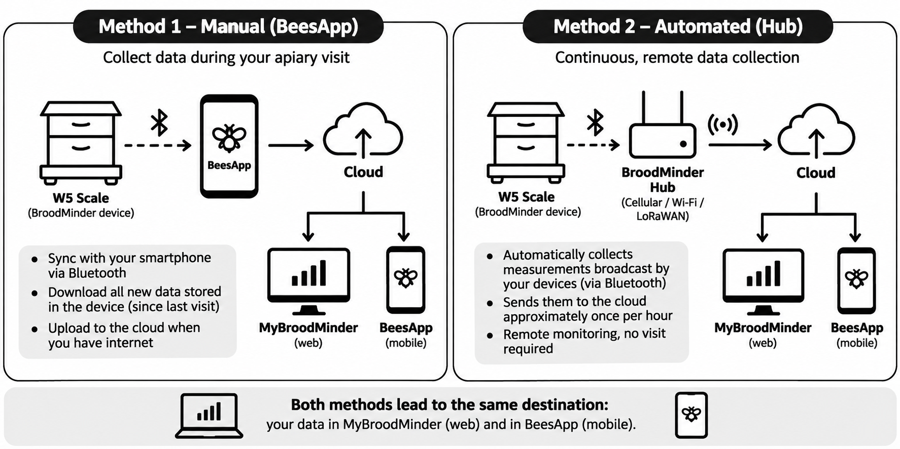

# Frequently Asked Questions (FAQ)

Find answers about choosing BroodMinder equipment, collecting data, understanding your colonies, and troubleshooting your monitoring system.

## 1. Getting started and choosing equipment

### Which sensors should I start with?

For a simple introduction to hive monitoring, start with an internal hive sensor:

- **BroodMinder-T:** measures internal hive temperature.
- **BroodMinder-TH:** measures internal hive temperature and humidity.

Both help you understand colony activity, brood development and overwintering conditions.

For a more comprehensive understanding of your colonies, we recommend combining internal sensors with a hive scale. Weight measurements provide additional insights into nectar flows, food reserves and colony productivity.

### Which kit should I choose?

BroodMinder offers several kits depending on your monitoring objectives:

- **Hobbyist Kit:** a simple way to start monitoring several colonies with internal sensors.
- **Citizen Science Kit:** combines a hive scale with two internal sensors, allowing you to monitor both colony conditions and weight variations.
- **Live Apiary Kit:** combines a W5 hive scale, two internal sensors and a Hub for automated remote monitoring.

BroodMinder is a modular system. You can start with a few devices and gradually add sensors, scales or Hubs as your apiary grows and your monitoring needs evolve.

### How many sensors do I need?

We recommend starting with at least one internal temperature sensor, but ideally monitoring three or more hives. Since colonies naturally evolve throughout the season, monitoring a single hive gives you valuable insights but no reference for comparison. With three or more monitored colonies, you can compare their development, distinguish seasonal trends from colony-specific changes, and more easily identify unusual behavior.

Adding a scale to one or more hives provides complementary information about nectar flows and food consumption.

You do not necessarily need a scale on every hive to gain valuable insights into your apiary.

### Where can I find installation instructions?

Start with the [Quick Start Guide](https://doc.mybroodminder.com/20_quick_start_guide/).

More detailed documentation and video guides are available through the **Documentation** section of MyBroodMinder and BroodMinder's video resources.

## 2. Data collection and connectivity

### How does BroodMinder collect data?

BroodMinder devices measure hive conditions, store measurements in their internal memory, and broadcast their latest readings over Bluetooth.

There are two distinct methods for collecting data:

- **Manual collection:** using your smartphone and BeesApp during apiary visits.
- **Automated collection:** using a BroodMinder Hub for continuous remote monitoring.

#### Manual data collection – Using BeesApp

With the **BroodMinder Bees app (BeesApp)** installed on your smartphone, you can collect data whenever you visit your apiary.

1. Open BeesApp and make sure Bluetooth is enabled.
2. Move within Bluetooth range of your devices.
3. Synchronize your devices:
    - With a **Free account**, synchronize devices individually from the **Devices** tab.
    - With a **Premium account**, use **Manage > Sync** to synchronize nearby devices in sequence.
4. The app downloads all new measurements stored in each device since its last synchronization.
5. The collected data is uploaded to MyBroodMinder when your smartphone has an internet connection.

Unlike other Bluetooth devices such as headphones, BroodMinder devices do not require Bluetooth pairing with your smartphone.

!!! note
    Manual synchronization provides historical data up to the time of your visit. BeesApp does not continuously collect and upload sensor measurements in the background. Your smartphone does not replace a Hub for remote monitoring.

#### Automated data collection – Using a Hub

For continuous remote monitoring, install a **BroodMinder Hub** in your apiary.

The Hub automatically listens to the Bluetooth measurements broadcast by nearby BroodMinder devices and uploads them to the cloud approximately once per hour.

Depending on the Hub model, the connection to the cloud is established through a cellular, Wi-Fi or LoRaWAN network.

This method does not require your smartphone to be present or any manual intervention. You can monitor your colonies remotely from BeesApp or MyBroodMinder.

#### Comparing the two methods

| Feature | Manual – BeesApp | Automated – Hub |
| --- | --- | --- |
| Data collection | Manual synchronization | Automatic |
| Equipment required | Smartphone | BroodMinder Hub |
| Data source | Measurements stored in device memory | Measurements broadcast over Bluetooth |
| Bluetooth pairing required | No | No |
| Apiary visit required | Yes | No |
| Data availability | After each synchronization | Approximately every hour |
| Continuous remote monitoring | No | Yes |
| Remote SwarmMinder alerts | No | Yes |
| Membership required | Free for up to 5 hives | Premium |

Both methods are compatible and can be used together. Regardless of the collection method, your data is available in **BeesApp** and **MyBroodMinder**.

### Do sensors store measurements when I am away?

Yes. BroodMinder sensors continue to measure and record data independently, even when no smartphone or Hub is nearby.

Devices typically record measurements hourly and can retain approximately one year of data in their internal memory, often more than 7,000 readings.

You do not need to visit your apiary or synchronize your devices every day.

!!! tip
    We recommend synchronizing your devices regularly to keep your cloud data up to date and avoid transferring excessively large amounts of data in a single synchronization.

### Do I need a Hub?

A Hub is not required to use BroodMinder devices.

However, you will need one if you want to:

- Monitor your colonies remotely.
- Receive automatic hourly data updates.
- Receive remote alerts, including SwarmMinder notifications.
- Collect data without visiting your apiary.

You can start with manual data collection and add a Hub at any time.

### Which Hub should I choose?

Choose your Hub according to the connectivity available at your apiary:

- **Cellular Hub:** the most convenient option where cellular coverage is available. It comes with a preconfigured SIM card.
- **Wi-Fi Hub:** suitable when your apiary has access to a reliable Wi-Fi network.
- **LoRaWAN Hub:** suitable for installations with access to a compatible LoRaWAN infrastructure.

### How many Hubs do I need?

A single Hub can collect measurements from multiple BroodMinder devices, provided they are within Bluetooth range.

Place the Hub centrally in your apiary. Reception range depends on the device type, hive construction and surrounding obstacles.

Hive scales can reliably reach 20 m or more, while internal hive sensors generally have a shorter range. When planning your installation, consider approximately 10 m for internal sensors.

If you have several geographically separated apiaries, you will generally need one Hub per apiary to monitor them all remotely.

You can also combine automated monitoring at one apiary with manual synchronization at another. All your hives remain accessible from the same BroodMinder account.

### When does MyBroodMinder update my data?

Different types of data are updated at different intervals:

| Data type | Update frequency |
| --- | --- |
| Manual synchronization | After your smartphone uploads the collected data |
| Automated Hub measurements | Approximately every hour |
| Daily calculations (weather, brood, weight and related indicators) | Twice daily, around 06:30–07:30 UTC and 12:30–13:30 UTC |
| Missing data and device/hive location reconciliation | Overnight, around 01:00–03:00 UTC |

Local times vary with daylight-saving time.

## 3. Apps, accounts and subscriptions

### Which BroodMinder app should I use?

**BroodMinder Bees (BeesApp)** is the current mobile application for managing your monitoring system, collecting data and viewing your hive measurements.

You can also access your data from any web browser through [MyBroodMinder.com](https://mybroodminder.com).

Both platforms use the same BroodMinder account and provide access to your apiaries, hives and devices.

Older applications may still be encountered but are legacy products:

- **BroodMinder / BroodMinder Lite (2016–2018):** an earlier application for viewing sensor data, graphs, exports and inspection notes. **Deprecated.**

    

- **BroodMinder Apiary (2018–2022):** an earlier application supporting data collection from multiple sensors. **Deprecated.**

    

- **BroodMinder Cell:** a separate application used to configure legacy Hub models 44 and 50.

    

### What can I do with a Free account?

The Free account allows you to monitor up to **five hives** without a subscription.

It includes:

- Manual device synchronization using BeesApp.
- Cloud data storage.
- Access to hive measurements and graphs in MyBroodMinder.

It is a great way to get started with BroodMinder if you are comfortable collecting data during your apiary visits.

### What does Premium add?

BroodMinder Premium unlocks additional features to help you monitor your colonies remotely, gain deeper insights and manage your apiaries more efficiently.

**Data collection and monitoring**

- **Bulk synchronization:** synchronize nearby devices in sequence using the **Manage** tab in BeesApp.
- **Remote monitoring:** use a BroodMinder Hub for automated hourly data uploads.
- **Remote alerts:** receive notifications about important colony events, including SwarmMinder alerts when using a Hub.

**Advanced analytics**

- **Colony Productivity:** track nectar collection and daily weight changes.
- **Brood Level:** monitor brood development and colony strength.
- **Nectar Flow Index:** assess environmental conditions for nectar production.
- **Weather Forecast:** anticipate weather conditions affecting your bees.
- **PhenoCast Bloom Model:** predict flowering periods and potential forage availability.
- **Forager Activity:** access forager activity counts when using BeeDar.

### How much does a subscription cost?

| Membership | Price | Main features |
| --- | --- | --- |
| Free | €0 | Manual data collection for up to 5 hives |
| Premium | €50/year | Hub connectivity, advanced analytics, bulk synchronization and remote alerts |

For cellular Hubs, the Premium membership includes the SIM card and cellular connectivity.

A Premium membership is required to use a Hub.

## 4. Understanding hive data

### What can temperature and humidity tell me?

During active brood rearing, bees regulate brood-nest temperature near 35°C (95°F).

Stable internal temperatures can indicate active brood thermoregulation. If hive temperature increasingly follows outdoor temperature, consider inspecting the colony.

Humidity readings provide additional insight into the hive's internal environment.

Always interpret sensor readings alongside the season, sensor placement and other observations.

[Learn more →](https://doc.mybroodminder.com/50_mybroodminder_v5c_temperature/)

### What is the Brood Level indicator?

Brood Level estimates colony brood activity from patterns in internal hive temperature and expresses the result as a percentage.

Higher values generally indicate stronger brood thermoregulation, while a decline can prompt closer observation or inspection.

It is an estimate, not a direct count of brood cells. Relative changes over time are particularly useful for monitoring colony development.

[Learn more →](https://doc.mybroodminder.com/50_mybroodminder_v5c_temperature/)

### Why monitor hive weight?

Weight monitoring helps you:

- Identify nectar flows.
- Track winter food reserves.
- Monitor colony development.
- Detect sudden changes without opening the hive.

A rapid weight drop may accompany swarming or other disturbances, while unexpected variations can also indicate theft, predator activity or equipment issues.

[Learn more →](https://doc.mybroodminder.com/50_mybroodminder_v5d_weight/)

### What does Colony Productivity measure?

Colony Productivity uses hive-scale weight measurements to calculate the daily net gain or loss generated by the bees, excluding beekeeper interventions such as feeding or adding supers.

It helps identify nectar flows, monitor colony performance and compare hives without relying solely on their absolute weights.

Productivity can be positive during nectar flows or negative when colonies consume their reserves.

[Learn more →](https://doc.mybroodminder.com/50_mybroodminder_v5d_weight/#productivity)

### What is the Nectar Flow Index (NFI)?

The Nectar Flow Index uses weather conditions, including temperature, humidity, rainfall and wind, to estimate how favorable the environment is for nectar production.

It describes potential conditions rather than measuring nectar actually collected by your bees.

The index does not account for whether plants are currently blooming, so it should be interpreted alongside local flowering conditions.

[Learn more →](https://doc.mybroodminder.com/50_mybroodminder_v5h_weather/#indexes)

### What is Colony Fitness?

Colony Fitness is a quick-status indicator displayed in BeesApp and MyBroodMinder.

Color-coded states help prioritize inspections:

- **Green:** favorable colony status.
- **Orange:** potential disturbance or decline.
- **Red:** potentially serious issue requiring attention.

It provides an at-a-glance assessment of colony condition but is not a substitute for physical hive inspections.

[Learn more →](https://doc.mybroodminder.com/50_mybroodminder_v5c_temperature/)

### What does BeeDar measure?

BeeDar uses radar technology to monitor bee movement at the hive entrance without disturbing the colony.

It estimates incoming and outgoing bee traffic, providing insights into foraging activity and how it responds to weather and environmental conditions.

These measurements help beekeepers understand daily foraging patterns and compare colony activity over time.

[Learn more →](https://doc.mybroodminder.com/50_mybroodminder_v5e_foraging/)

### Can BroodMinder help detect swarming?

Yes. SwarmMinder detects rapid temperature changes associated with swarming activity.

Compatible internal sensors monitor temperature at short intervals and identify patterns that may indicate a swarm event.

When used with a Hub, the system can deliver timely remote notifications, allowing you to react quickly.

An alert indicates a possible event and should be interpreted alongside other hive observations.

[Learn more →](https://doc.mybroodminder.com/50_mybroodminder_v5f_alerts/#swarmminder-sms-alerts-beta)

## 5. Maintenance and troubleshooting

### Are the batteries replaceable?

Yes. BroodMinder devices are designed to be used for many years, with replaceable batteries.

The battery type depends on the device model:

- **Internal T2/TH2 sensors:** typically CR2032 coin cells.
- **Hive scales and other devices:** typically standard AA batteries.

Always check your device's specifications before purchasing replacement batteries.

### How long do batteries last?

Battery life depends on the device, battery type and operating conditions.

Under normal conditions, you can expect:

| Device | Expected battery life |
| --- | --- |
| Internal sensors T2 and T3 generations (before 2027) | ~1 year |
| Internal sensor T4 (available from 2027) | ~4 years |
| Hive scales | ~4 years |
| BeeDar (4 AA batteries) | ~5 months |

We recommend checking battery levels during the autumn harvest to ensure uninterrupted monitoring throughout winter.

### Should I synchronize before performing device maintenance?

Yes. Always synchronize your device before:

- Removing or replacing its battery.
- Updating its firmware.
- Clearing its internal memory.

These operations may erase stored measurements.

Make sure all recorded data has been uploaded to MyBroodMinder before proceeding.

### Why can't I connect to or synchronize a sensor?

Bluetooth connectivity depends on the distance between your smartphone and the sensor, as well as surrounding obstacles.

Metal hive covers, queen excluders and foil insulation can reduce signal strength.

If you are having trouble connecting or synchronizing, follow these steps:

**1. Get closer to the sensor.**

Move your smartphone as close as possible to the device.

**2. Check device availability in BeesApp.**

Open the **Devices** tab and locate your sensor. It should display a green Bluetooth icon with **Available** written underneath.

- If the sensor is not available, check its battery and replace it if necessary. When you insert a new battery, an LED should blink to indicate that the device is functional.
- If the sensor is available, Bluetooth communication is working. Proceed to synchronization.

**3. Try synchronizing the sensor.**

If synchronization fails repeatedly, the sensor may have accumulated a large number of readings in its internal memory.

In rare cases, transferring this amount of data can exceed the smartphone's Bluetooth buffering capacity.

Try using another smartphone, which may handle the transfer differently.

!!! tip "Best practices for reliable synchronization"
    - Synchronize your devices regularly.
    - Whenever possible, keep the number of stored readings below 7,000 samples.
    - After successfully uploading your data, you can clear the device's internal memory using BeesApp. [Learn more →](/40_beesApp/#advanced-device-management)

If the problem persists, contact [support@broodminder.com](mailto:support@broodminder.com).

## 6. Sharing, privacy and support

### Can I share my apiary data with others?

Yes. MyBroodMinder supports sharing apiary access with selected people, such as family members, fellow beekeepers or researchers.

See the [sharing instructions](https://doc.mybroodminder.com/50_mybroodminder_v5/#sharing).

You can also contribute to broader research through **BeeCounted**.

### Is my exact apiary location visible on BeeCounted.org?

No. BeeCounted displays only an approximate region or postal-code area, not your exact GPS coordinates or street address.

### Where can I get help?

For technical support, email [support@broodminder.com](mailto:support@broodminder.com) or submit a support ticket through BeesApp.